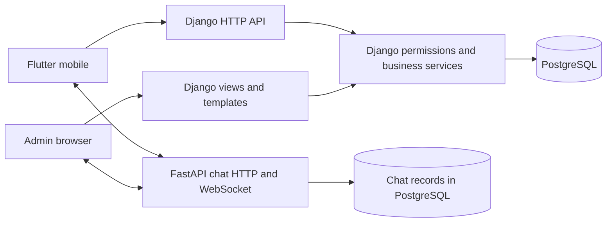

# CampusHub System Overview

CampusHub is a campus marketplace and facilities booking system with real-time availability monitoring and an analytics dashboard for the University of Science and Technology of Southern Philippines - Oroquieta Campus.

Reviewed October 28, 2026. This is the whole-project orientation and planning map. Detailed implementation reports, troubleshooting and verification evidence remain in the existing feature guides. Start from the [repository README](../README.md) when choosing which document to read.

## Purpose

CampusHub brings campus product sales, facility reservations and specialized service requests into one system. Mobile users submit requests and track their records, while authorized web administrators manage the relevant operations. Dashboards summarize recorded activity and provide links to the detailed workspaces.

This is a BSIT capstone and research project at USTP Oroquieta. Its operational scope covers marketplace transactions, seller management, diverse booking/service workflows, account permissions, communication, notifications, analytics and decision support. Scope does not imply completion: a source file, a passing isolated test and institutional acceptance are different kinds of evidence.

## How to read project documentation

| Layer | Purpose | Current reference |
| --- | --- | --- |
| Product plan | Who uses the system, which problems it solves and its boundaries | [Product brief](../PRODUCT.md), [delivery plan below](#project-plan-and-acceptance-evidence) |
| Engineering rules | Technology ownership, permissions, official workflows and response requirements | [AGENTS.md](../AGENTS.md) |
| Current decisions | Latest accepted changes, superseded choices and reported verification | [Project context](../CAMPUSHUB_CONTEXT.md), newest relevant entry first |
| Architecture | Components, module boundaries, data flow and where to put code | This overview and [backend architecture](../backend/core/modules/ARCHITECTURE.md) |
| Design | Visual rules, navigation, states, responsive behavior and typography | [Web rules](web-ui-ux-guidelines.md), [mobile reference](../campushub/DESIGN.md), [current mobile typography](mobile-typography.md) |
| Feature implementation | Exact functions/files, cause, behavior, tests and debugging | [Feature documentation index](#feature-documentation-index) |
| Release/operations | Installation, deployment, recovery, ownership and acceptance | [Deployment](kamatera-web-deployment.md), [turnover](system-turnover-checklist.md) |

Current explicit user instructions take priority. Then use engineering rules and the latest relevant context/feature entry. Older design records are historical where they conflict with an accepted later change. Runtime source shows what is implemented; a document alone is not proof of the currently deployed version.

## Applications and architecture

| Part | Technology | Responsibility |
| --- | --- | --- |
| Web administration and main backend | Django | Products, orders, facilities, bookings, accounts, permissions, reports and decision support. |
| Main API | Django REST Framework | Exchanges authorized application data with the mobile app. |
| Mobile app | Flutter / Dart | User-facing marketplace, booking and account experiences. |
| Database | PostgreSQL | Stores application records; pgAdmin is a management tool for PostgreSQL. |
| Chat service | FastAPI | Messaging only; marketplace and booking business rules remain in Django. |

Hosting PostgreSQL on a remote server does not change its database engine. The app's API address, Django's database connection and the chat service address are separate configuration concerns.



The two database symbols show ownership of application versus chat records; they do not assert two independent database servers. Django remains authoritative for account/seller access, products, orders, stock, facilities, bookings, reports and decision support. Chat validates the existing issued credentials and handles messaging; it does not become the application business backend.

## Folder structure and ownership

```text
backend/
|-- core/
|   |-- manage.py
|   |-- core/                   Django settings, URLs and middleware
|   |-- accounts/               Account/authentication/role models and services
|   |   `-- migrations/         Account schema history
|   |-- api/                    Existing shared models and mobile/API adapters
|   |   `-- migrations/         Existing marketplace/facility/shared schema history
|   `-- modules/
|       |-- marketplace/        Product/order adapters and business services
|       |-- facilities/         Booking/service adapters and workflow helpers
|       |-- user_management/    Administrative user/role workflows
|       |-- reports/            Dashboard/report aggregation and views
|       |-- notifications/      Notification/email adapters and services
|       `-- messages/           Administrative messaging integration
|-- templates/                  Shared/admin templates, including Super Admin views
|-- static/                     Shared web CSS, JavaScript, fonts and images
`-- chat_service/
    |-- app/                    Chat-only FastAPI implementation
    `-- alembic/                Chat-owned schema migrations

campushub/
|-- lib/main.dart               Normal Flutter application startup
|-- lib/module_app/
|   |-- config/                 API addresses and configuration helpers
|   |-- routes/                 Named routes and onboarding destination selection
|   |-- screens/                Screen composition and UI state
|   |-- widgets/                Reusable Home/navigation/profile/seller components
|   |-- services/               Existing API, device and application service clients
|   |-- models/                 Response parsing and typed presentation data
|   |-- session/                Existing saved-session handling
|   |-- theme/                  Shared typography and visual tokens
|   |-- controllers/            Existing UI/controller helpers
|   |-- utils/                  Shared utility functions
|   `-- validation/             Input-validation helpers
|-- assets/                     Bundled fonts, images and licenses
|-- test/                       Isolated Flutter tests and render harnesses
|-- tool/                       Existing development/QA tools
`-- android/, ios/, ...         Flutter platform integration
```

Keep existing Django model/migration ownership intact. Grouping views/services into `modules/` does not move the PostgreSQL schema into a new app. Do not relocate models or migration files just to make folders look more uniform. See the [backend architecture](../backend/core/modules/ARCHITECTURE.md) for module-specific conventions and compatibility imports.

`backend/core/core/settings.py` configures `backend/templates/` and app template discovery; module templates live in namespaced `templates/<module>/` directories. Shared web assets live under `backend/static/`, with additional module static files where implemented. `frontend/` contains extra static/admin/reference files; confirm actual imports/routes before treating any of them as served pages. `scratch/`, `output/` and local tool state are review/support material rather than application entry points; do not move evidence into production assets without a feature reason.

## Accounts and access

Account types include Student, Faculty/Employee, Guest/External and Admin. Seller access is a separate approval status rather than an account type.

Super Admin oversees the system. Marketplace Admin and Facility Admin work within their existing permissions and assigned scope. Django enforces access on the server; hiding a menu item alone does not grant or protect access.

The final active Super Admin must not be deleted, deactivated or demoted. This protection and seller approval/ownership checks belong to the existing backend rules, regardless of which menu is visible.

Where marketplace Program/Major scoping applies, it follows the existing seller/product relationships, not the buyer's Program/Major.

## Main modules

### Marketplace

The marketplace covers products, seller access, variants, inventory, FIFO-related stock handling and orders. Fulfillment is **Pickup** or **Seller Delivery**, with the existing cash-recording workflow kept separate. There are no couriers, gateways or added delivery fees in the approved scope; historical fulfillment remains unclassified if it was not recorded.

The established order flow is Pending, Confirmed/Processing, Ready for Pickup, then Completed, with cancellation handled by the existing workflow. Eligible completed and paid transactions supply marketplace sales analytics. Pending or unpaid order values must not be described as collected sales.

Seller Delivery uses its existing delivery progress. Marking Delivered does not mark Paid; delivered unpaid orders remain open/reserved until explicit payment confirmation and completion. Cancellation after Delivered is blocked; returns/refunds have a separate approval workflow. These are existing business constraints, not rules introduced by this documentation update.

### Facilities

Facilities supports reservations and availability checking. Booking behavior depends on the facility: event/slot reservations differ from accommodation bookings and specialized requests. A facility being **Open for Booking** does not mean every time slot is free.

Covered Court/Function Hall use event or slot conflict checks; hostel requests need room/date/guest/night details; Training Kitchen/Assessment workflows have their own scheduling requirements; commercial spaces use lease applications. Operational statuses are Open for Booking, Temporarily Unavailable, Under Maintenance and Inactive. Consult the relevant feature guide before changing a workflow or API.

Official approval, payment, document, inspection and completion steps follow the existing facility workflow. A dashboard layout change does not change those steps.

### Services

Specialized services such as Food Analysis, BPP Assessment and lease applications have their own requirements and processing steps. They must not be treated as ordinary event bookings merely because they use related campus resources.

For example, the approved Food Analysis procedure includes sample receiving checks, resource checks, job-order processing, analysis, cashiering and release of results. Refer to the project's verified workflow guidance before changing service behavior.

### Reports and decision support

Analytics summarizes recorded activity: sales trends, product rankings, booking demand, service requests and account registrations.

Suggested product bundles provide decision support using association rules generated with the Apriori algorithm. The Super Admin dashboard previews existing saved product combinations and seller responses; it does not run Apriori on every dashboard visit. Ordinary dashboard UI does not expose Support, Confidence or Lift.

Charts describe activity. They should not be labelled forecasts or trained AI models. Empty states appear when eligible records are absent; demonstration data must not be presented as real production activity.

Demand forecasting and alternative-schedule recommendations are separate decision-support objectives. Their model/data/evaluation or conflict-recommendation implementation must be verified independently; existing charts or product-ranking endpoints do not prove those objectives are complete. Never fill sparse history with invented forecast numbers. Push-notification behavior likewise has a dedicated [implementation guide](mobile-fcm.md); source/history does not prove end-to-end delivery on every device or deployed build.

## Design and navigation structure

Web uses the existing Inter UI font, SugarPie wordmark, navy `#1A1851`, gold `#FCB316`, disciplined tables, restrained borders and the [global UI/UX rules](web-ui-ux-guidelines.md). Current Flutter Home and navigation use Inter headings 600, menu labels 500, KPI numbers 700 and descriptions 400. The app-wide Poppins default, SugarPie wordmark and Montserrat profile identity remain explicit exceptions. Flutter retains its existing mobile gold `#FCB315`. Use [mobile typography](mobile-typography.md) for the actual helpers/font assets, and [DESIGN.md](../campushub/DESIGN.md) for component context.

Regular users and approved sellers share the existing Home and underlying tab shell. Seller permission adds existing owner-scoped tools; it is not a separate account type or replacement root app. The regular navigation is Home, Marketplace, Services, Facilities and Profile. Approved sellers see Home, Marketplace, Add Product, Services and Facilities; Add Product is an action, while Profile remains reachable through its existing header/drawer path.

Current seller Home reading order:

1. Welcome header and promotional banner.
2. Sales Overview: Total Sales, Total Orders, Completed Orders and Pending Orders.
3. Suggested Product Bundles, directly below the KPI cards.
4. Recent Orders: manual carousel of the latest five rows from the existing owner-scoped first page.
5. Inventory Attention: compact existing stock alerts.
6. Sales Trend: actual eligible seller transactions.
7. Explore CampusHub: Marketplace, Facilities and Services previews.

Keep existing details/See All routes, sidebar grouping, saved-session behavior and server authorization. Each screen must distinguish loading, successful content, empty data and errors, and remain usable at narrow widths/large text. Layout examples do not authorize fabricated orders, users, products, utilization or recommendations.

## Function entry points and data flow

| File and anchor | Inputs | Outputs / next step |
| --- | --- | --- |
| `campushub/lib/main.dart` - `main()` | Flutter runtime and existing saved cart/theme | Initializes the real app and schedules existing push startup after the first frame |
| `campushub/lib/module_app/routes/app_routes.dart` - `AppRoutes.forUser(user)` | AuthUser profile/onboarding state | Existing profile/preferences/welcome/dashboard route |
| `campushub/lib/module_app/services/product_service.dart` - `fetchApproved()` | Configured API URLs and optional client/timeouts | Approved catalog response parsed into ProductItem records, or an explicit load error |
| `backend/core/api/views.py:870` - `approved_products(request)` | Existing catalog request and visibility rules | JSON product list; `serialize_product` at line 219 supplies the shared product representation |
| `campushub/lib/module_app/screens/seller_dashboard_page.dart:82` - `_load()` | Real user, selected reporting period/order page | Existing seller-status check, then workspace data or explicit denial/error state |
| `campushub/lib/module_app/services/seller_application_service.dart:92` - `workspace()` | Existing session headers, period and order page | Authenticated JSON from the existing seller workspace endpoint |
| `backend/core/modules/marketplace/mobile_seller_views.py:24` / `:70` - `approved_seller` / `workspace` | Authenticated request and approved active seller | Owner-scoped products/orders/stock, original paid-sales analytics and recommendation presentation |
| `campushub/lib/module_app/screens/seller_workspace_content.dart` - `homeHighlights(context)` | That same workspace snapshot and existing callbacks | Current summary order, actual values and navigation to existing tools |
| `backend/core/core/urls.py` | Request URL | Existing Django API or web view; business helpers remain in their owning domains |
| `backend/chat_service/app/main.py` | Existing chat HTTP/WebSocket request | Messaging application; follow the chat README for its issued-token and schema setup |

Mobile read example:

```text
Home opens -> ProductService.fetchApproved()
  -> GET /api/products/approved/
  -> Django approved_products + visibility/serialization
  -> PostgreSQL records -> JSON -> ProductItem -> existing preview card
```

Seller read example: `_load -> status -> workspace -> approved_seller -> seller_order_queryset(account) -> existing analytics/inventory/recommendation helpers -> JSON -> homeHighlights`. Taking five recent rows does not load all historical pages or create records. Total Sales still comes from completed and paid transactions; a UI read never marks an order paid. Django web views instead return templates/context or existing dashboard JSON, using the same domain authority.

This separation lets screen layout evolve without duplicating accounting, stock or approval rules in Flutter. For changes that write records, trace the existing authorized POST and transaction helper in the relevant feature guide; do not infer a new write API from these read examples.

## Project plan and acceptance evidence

Use the following as a delivery plan, not an invented percentage-complete report. The documentation review confirmed source and guides exist; it did not rerun every feature, inspect the live deployment or obtain institutional acceptance.

| Stage | Deliverable | Completion evidence |
| --- | --- | --- |
| 1. Scope and requirements | Actors, modules, official workflows, constraints and approved exclusions | Agreed product/rule references and traceable requirement IDs |
| 2. Architecture and records | Component ownership, API contracts, model relationships and existing migration ownership | Source-linked module/data-flow map; reviewed schema/migration plan for any proposed change |
| 3. Experience and design | Role-specific journeys, screen hierarchy, shared tokens and honest states | Current design references plus responsive/accessibility checks and inspected renders |
| 4. Feature implementation | Existing Django services/APIs, Flutter screens and chat integration | Reviewed source and feature guide with functions, inputs/outputs, cause and exact anchors |
| 5. Verification | Authorization, ownership, order/payment, inventory, booking conflicts and UI behavior | Actual isolated test outputs; populated/empty/error/large-text and cross-role checks |
| 6. Integration and operations | Real configured service connections, backups, recovery and deployment | Tested intended environment/revision, restore rehearsal, release/rollback evidence |
| 7. Turnover and research | User/admin guidance, training, evaluation, limitations and maintenance ownership | Institutional acceptance, named owners, reproducible evaluation and turnover record |

Keep an evidence-backed requirement list when deciding remaining work: requirement, source/guide, latest actual test, environment/revision, unresolved issue and acceptance owner. Record an unknown status as unverified rather than marking it complete because a menu or file exists. There are no new deadlines, assigned personnel, deployment actions or guessed future features in this plan. The [turnover checklist](system-turnover-checklist.md) holds the existing release/organizational acceptance items.

## Feature documentation index

| Domain | Existing guides |
| --- | --- |
| User access and administration | [User management](user-management.md), [roles/permissions](roles-permissions.md), [marketplace support](marketplace-admin-support.md) |
| Products, stock and orders | [Product list/inventory](products-list-inventory.md), [variants](variant-inventory.md), [thresholds](product-low-stock-threshold.md), [FIFO](fifo-inventory.md), [orders](orders-module.md) |
| Seller access and Home | [Seller implementation](mobile-seller-application.md), [bundles/Apriori](suggested-product-bundles.md), [bundle components](component-bundles.md) |
| Facilities and services | [Facility configuration](facility-configuration.md), [booking context](booking-module-chatgpt-context.md), [service configuration](service-configuration.md), [mobile services](mobile-services-navigation.md) |
| Mobile account/discovery | [Profile/onboarding](mobile-profile.md), [typography](mobile-typography.md), [product loading](mobile-product-loading.md), [notifications](mobile-fcm.md) |
| Dashboards and reporting | [Super Admin dashboard](dashboard-analytics-operations-update.md), [Marketplace](dashboard-marketplace-design.md), [Facility Admin](facility-admin-dashboard.md), [analytics](superadmin-analytics-module.md) |
| Development/operations | [Debugging](DEBUGGING_GUIDE.md), [backend architecture](../backend/core/modules/ARCHITECTURE.md), [Flutter](../campushub/README.md), [chat](../backend/chat_service/README.md), [database/backup](database-backup-neon.md), [deployment](kamatera-web-deployment.md), [turnover](system-turnover-checklist.md) |

Feature guides can contain historical snapshots. Read their newest relevant section together with the context and source. Their old test counts are evidence for that recorded change, not a current full-project test result.

## Super Admin dashboard reference

The documented Super Admin layout follows this reading order; see the latest [dashboard guide](dashboard-analytics-operations-update.md) and current template for later refinements:

1. Welcome message and reporting-period controls.
2. System Overview KPIs, with Suggested Product Bundles beside them on desktop.
3. Attention Required, inside the left column directly below the KPI cards.
4. Marketplace Overview.
5. Facilities Overview.
6. Services Overview.
7. Users Overview.
8. Recent System Activities.

On desktop the System Overview row keeps approximately 70% for the KPIs and Attention Required on the left, with the saved recommendation panel on the right. On smaller screens the order is KPIs, Attention Required, then recommendations. Both columns use their content heights.

The System Health display and Check status action were removed from this dashboard at the user's request on October 24, 2026. Existing protected health checks remain backend functionality.

Major headings and subtitles sit outside individual content cards. Chart and list titles stay inside their cards. The recommendation companion keeps its title inside its own card.

The recommendation panel previews up to two current eligible saved product pairs, with real product photos or placeholders, names, seller and saved response/delivery state. Separate counts show Sent to Sellers, Awaiting Seller Response and Bundles Created. Its View Recommendations link opens the existing detailed workspace; the Super Admin dashboard has no send/create/approve/reject actions.

## How data reaches the dashboard

The browser requests the dashboard from Django. Existing view and helper functions apply authorization, reporting dates and eligibility rules, then read PostgreSQL records. Django passes the results to templates and existing chart scripts. Date-filter refreshes use the existing dashboard API.

Relevant implementation entry points:

| File / anchor | Inputs and outputs |
| --- | --- |
| `backend/core/modules/reports/views.py` - dashboard view and `admin_dashboard_page` route | Authenticated request and selected filters enter; dashboard context and HTML leave. |
| `backend/templates/dashboard/partials/executive_dashboard.html` - `data-executive-dashboard` | Receives existing dashboard context; includes the Super Admin sections in reading order. |
| `backend/core/modules/marketplace/services/bundle_suggestions.py` - `dashboard_bundle_suggestions(user, limit=...)` | Receives the authorized user and preview limit; returns saved recommendation presentations and activity counts without mining on GET. |
| `backend/core/modules/marketplace/services/bundle_monitoring.py` - `presentation(row)` and `activity_summary(user)` | Maps actual saved relationships into product/seller/response text and aggregates saved workflow activity. |

For example, an eligible paid order can contribute to recorded marketplace revenue. Opening the dashboard reads the resulting totals; it does not create another order. Likewise, showing a saved bundle suggestion does not send it to a seller.

## Further reading

- [Dashboard implementation, layout, verification and troubleshooting](dashboard-analytics-operations-update.md).
- [Saved bundle recommendations and seller-response behavior](suggested-product-bundles.md).
- [Marketplace Admin dashboard](dashboard-marketplace-design.md).
- [Global web UI/UX rules](web-ui-ux-guidelines.md).
- [Project context and reference history](../CAMPUSHUB_CONTEXT.md).
- [Project engineering and verified workflow rules](../AGENTS.md).

## Safe learning exercise

First, trace a mobile read without running any write command: open `ProductService.fetchApproved`, find `/api/products/approved/` in `core/urls.py`, then inspect `approved_products` and `serialize_product`. Verify the output key `products` matches the mobile parser and identify where ProductItem is created. Explain which layer presents the card and which layer decides visibility. No database changes or network request are needed for this exercise.

Open `executive_dashboard.html` and match its includes to the dashboard sections listed above. Then open the recommendation panel partial at `backend/core/modules/marketplace/templates/marketplace/partials/super_recommendation_preview.html` and identify its product loop, three activity labels and existing View Recommendations link. This is read-only: verify the names against the running page without creating orders, changing records or generating example recommendations.

For debugging, identify the failing layer before editing: a missing Flutter import belongs to its package/SDK context; an HTTP 401/403 belongs to existing authentication/authorization; a denied seller must not be “fixed” by forcing a UI flag; a zero paid-sales total must be traced to eligible records before changing its display. Use existing tests against isolated environments. Do not apply migrations or point test writes at the working database merely to follow an overview.

## Documentation scope

Created October 24, 2026; expanded October 28 for the user's whole-project overview/documentation request.

1. **Cause / reason:** orientation was split among context, product, design and feature documents; the existing overview focused heavily on the Super Admin dashboard, the mobile README was generic Flutter boilerplate, and mobile design summary fonts lagged the accepted Inter change.
2. **Exact files changed / anchors:** root `README.md:1` (new navigation hub); this overview at line 1 and its `Project plan and acceptance evidence`/`Feature documentation index` headings; `campushub/README.md:1` (mobile-specific guide); `campushub/DESIGN.md:20` (`greeting` and current typography block); `CAMPUSHUB_CONTEXT.md:3` (latest entry). Five documentation files, no runtime source files.
3. **Changes made:** added a project reading map, architecture diagram, actual folder ownership, role/module/workflow explanation, current seller Home/design rules, source-linked functions/data flow, acceptance-oriented delivery stages and guide index. Clarified Pickup/Seller Delivery versus separate cash recording; refreshed the scoped design reference and mobile entry-point guide.
4. **How it works:** these files are read by people; runtime code does not consume this overview or README. The tables map questions to existing sources, while annotated read paths teach how screens/services/APIs/domain helpers connect. Existing feature reports retain detailed implementation history instead of duplicating it here.
5. **Backend / API behavior:** unchanged. No application, permission, endpoint, business helper or chat behavior was modified.
6. **Database / migration impact:** none. No application launch, database connection, schema command, migration or working-record write was required.
7. **Checks performed:** inspected existing directories, startup/routes/service/view anchors and current design decisions. Verified 89 local Markdown links and referenced headings across the five changed documents, balanced code fences, and checked the cited source paths/function lines. Runtime tests were not run because the changes are documentation only; earlier feature test results were not reclassified as current project verification.
8. **Remaining limitations:** this is a source-based overview and plan, not an exhaustive functional audit, fresh schema export, deployed-service check or institutional acceptance. Deployment/security and each domain's remaining issues belong to their dedicated guides and require evidence from the intended environment.
