# CampusHub Facilities and Services: Process Flows

**Prepared:** November 5, 2026

**Deliverable:** Markdown specification only

**Coverage:** Covered Court, Function Hall, Hostel Accommodation, Training Kitchen / Assessment Center, Food Analysis, commercial leasing, and Other configured resources.

This document describes the requested client screens and corresponding office processes. It does **not** implement online forms, endpoints, admin actions, migrations, or changes to working records. Existing application behavior and proposed behavior are distinguished below.

## 1. Reference materials and interpretation

| Reference | Used for | Limits |
| --- | --- | --- |
| `D:/Downloads/Photosss/mobile_facilities.png` | Seven-screen venue-booking sequence: details, schedule, booking details, review, submitted, tracking, approved. | Sample names, booking IDs, dates, photographs, colors and prices are examples, not database records or approved configuration. |
| `D:/Downloads/Facilities Services-20261019T184027Z-1-001.zip` | Photographed procedures: Hostel Accommodation and Function Hall Services (`DPM-USTP-Oro-BEU-001`), Lease of Space (`002`), Covered Court Rental (`003`), and Laboratory Food Analysis Services (`004`). | The archive contains 19 photographs and two videos. Relevant photographed procedure pages were inspected; the videos were not transcribed and are not used as evidence here. |
| `D:/Downloads/Approved_Policy_Rental_of_Facilities_and_Spaces_in_USTP_Oroquieta (1).pdf` | Facility categories, rental conditions, official collection, inspections, deposits, assessment conditions and commercial permits. PDF pages 33–35 and 38–39 are particularly relevant; these are physical PDF page numbers. | Presentation pages and the policy body contain differing details. Do not automatically import rates, capacities, discounts or schedules into live configuration from this document. |
| `D:/Downloads/sir_conmar_fil.txt` | Laboratory inquiry, sample checklist, job order, laboratory readiness, acceptance/disapproval, turnaround, analysis, cashier payment, results and feedback. | The two-week turnaround mentioned in the interview is an example, not a fixed deadline for every request. |
| `D:/Downloads/Propose_FM-USTP-ORO-BEU-01-Job Order Request.docx` | Actual Job Order Request field labels, six service choices and four signature roles; see [10.1](#101-job-order-request). | Proposed form, revision 00, blank effective date. Its printed code is `FM-USTP- ORO-BEU-01`. Blank fields and signatures are not completed institutional records. |
| `D:/Downloads/Propose_FM-USTP-ORO-BEU-02-Statement of Account.docx` | Actual billing fields, Job Order reference, itemized charges and four signature roles; see [10.2](#102-statement-of-account). | Filename says `02`, but the printed document code says `FM-USTP-ORO-BEU-01`. Effective date and account number are blank. Preserve this discrepancy for office confirmation; do not silently correct or activate the form. |
| Current CampusHub source and feature guides | Distinguish working features from features still needing implementation. | Code references describe the local source inspected on this date, not a deployed-server or physical-phone verification. |
| Existing Booking Slip documentation: [booking guide](booking-module-chatgpt-context.md#booking-slip), [official digital slip](facility-configuration.md#official-digital-booking-slip-inside-booking-details---2026-10-14), [category mapping](facility-configuration.md#automatic-booking-slip-by-facility-category---2026-10-14) | Saved reservation fields, rental/accommodation form selection, print/export and document distinctions; summarized in [10.6](#106-booking-slip--reservation-slip). | These describe existing application behavior. Generated paper and configured signatory names do not prove an actual signature, approval or payment event. |

The reference documents describe institutional procedures. They are source material for this specification, not instructions to execute changes to the application, permissions, accounts, prices or records.

### Current explicit project decisions

- Enabled **operating days and hours** determine potential booking dates. The user's latest decision supersedes the older Covered Court weekend-only restriction for the application. The difference from the supplied policy must remain visible for institutional reconciliation; this specification does not claim that the PDF itself was amended.
- Choosing a date must **not automatically select Available Hours**, including when only one window exists or the next date has identical hours.
- The user manually chooses a booking window. A valid time selection is still required before advancing.
- Django remains the authority for eligibility, availability, prices, approvals, payments and request processing. FastAPI remains chat-only.
- Payments use the existing cash-recording / authorized cashier workflow with official receipts. This specification introduces no online payment gateway.
- Booking status, payment status, document status and operational progress are separate concepts.
- Use actual configured facilities, rooms, rates, services and records. Empty or unavailable configuration must remain honest.
- Reuse the app's established components and typography. The reference image does not authorize replacing the current UI with sample records or introducing unrelated styling changes.

## 2. Resource-to-flow mapping

| Resource | Correct client flow | Key distinction |
| --- | --- | --- |
| Covered Court | Venue reservation | Date and exact time interval; conflicts and minimum duration apply. |
| Function Hall / event space | Venue reservation | Event details, capacity, configured charges, payment conditions and inspections. |
| Hostel / Mock Hotel | Accommodation | Check-in/out, nights, adults/children, actual room and occupancy. |
| Training Kitchen used for assessment | Assessment registration | Candidate eligibility, office-confirmed assessment schedule and actual results. |
| Training Kitchen configured as a bookable venue | Configured venue flow | Do not force an assessment-registration form onto an ordinary venue reservation. |
| Food Analysis Hub | Laboratory service request | Physical sample acceptance and laboratory readiness precede analysis. It is not a time-slot rental. |
| Cafeteria / canteen / food stall | Lease application | Letter of intent, evaluation, approval, agreement, permits, billing and operation. |
| Wi-Fi vendo / photocopying / printing space | Lease application | Machine/space configuration and applicable utility and rental terms. |
| Other | Flow selected from saved configuration | Never infer booking mode, forms or prices from the resource name. Unsupported/custom processes require an office-reviewed request and quote. |

### Individual process-flow index

| Facility / service | Dedicated process flow |
| --- | --- |
| Covered Court | [4.1 Covered Court](#41-covered-court) |
| Function Hall | [4.2 Function Hall](#42-function-hall) |
| Hostel / Mock Hotel | [5. Accommodation](#5-hostel-accommodation--mock-hotel) |
| Food Analysis Hub | [6. Laboratory Food Analysis](#6-laboratory-food-analysis) |
| Assessment Center / BPP NC II | [7.1 Assessment](#71-bpp-nc-ii-assessment) |
| Training Kitchen configured for rental | [7.2 Training Kitchen rental](#72-training-kitchen-as-a-bookable-facility) |
| Cafeteria / canteen spaces | [8.1 Cafeteria / canteen](#81-cafeteria--canteen-spaces) |
| Food stalls | [8.2 Food stalls](#82-food-stalls) |
| Wi-Fi vendo machine space | [8.3 Wi-Fi vendo](#83-wi-fi-vendo-machine-space) |
| Photocopying / printing machine space | [8.4 Photocopying / printing](#84-photocopying--printing-machine-space) |
| Other physical facilities | [9.1 Other physical facilities](#91-other-physical-facilities) |
| Other / custom services | [9.2 Other / custom services](#92-other--custom-services) |
| Job Order Request document | [10.1 Fields and processing](#101-job-order-request) |
| Statement of Account document | [10.2 Fields and processing](#102-statement-of-account) |
| Booking Slip / Reservation Slip | [10.6 Existing slip and workflow](#106-booking-slip--reservation-slip) |

## 3. Shared design and processing rules

### Client experience

1. Show actual resource details, location, configured rates, eligibility and requirements.
2. Request only the fields relevant to that resource's workflow.
3. Preserve entered information when validation fails, availability changes or a request needs review.
4. Show a review screen before submission, including the exact selected dates, quantities, requirements and known charges.
5. Clearly distinguish an estimate, an approved quote and an issued billing statement. An unpriced request must say **Awaiting office quotation**, not display a fabricated zero charge.
6. After a successful save, show the server's actual request ID and status. Never show a successful submission merely because a form was completed locally.
7. Provide tracking, permitted cancellation, available documents and the existing Message Admin / Message Office destination.

### Admin experience

1. Read the submitted information and evidence within the user's existing permission scope.
2. Recheck actual availability or service readiness at the relevant approval stage.
3. Record approval or a specific disapproval reason; do not silently discard a request.
4. Record issued document references and actual action times.
5. Record cashier payments independently from approval, using the actual amount, official receipt and payment date/time.
6. Advance only the stages supported by recorded evidence.
7. Complete inspections, release, handover, resolution or feedback steps appropriate to that workflow.

### Tracking rules

An instructional process diagram shows what normally happens. A transaction timeline shows what **actually happened to that request**. Do not mark an instructional stage completed without a corresponding saved event.

- Submitted time comes from the actual request creation record.
- Approval time comes from a recorded approval event, not `created_at`.
- Payment time comes from the payment record.
- A result-release time requires an actual release record.
- Unknown historical times should say **Date not recorded** or be omitted.
- Do not invent an Under Review timestamp or assume a completed review event exists because the record is approved.

## 4. Covered Court and Function Hall: venue reservation

This follows the reference image's seven-screen structure while retaining CampusHub's latest scheduling behavior.

### 4.1 Covered Court

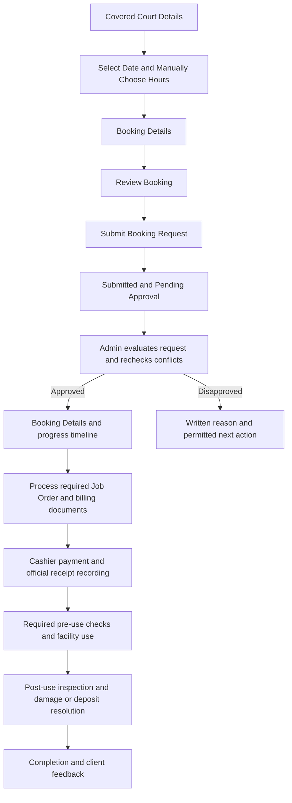

**Client:** view Court details -> select date and hours -> enter event/requester details -> review actual quote -> submit -> track the decision and payment -> view authorized documents.

**Office:** verify purpose, capacity and conflicts -> approve or disapprove -> issue required documents -> record cashier payment -> coordinate access and required inspections -> assess actual damage or additional charges -> resolve any applicable deposit -> complete and obtain feedback. A deposit is included only when the Court's actual authorized configuration requires it.

### 4.2 Function Hall

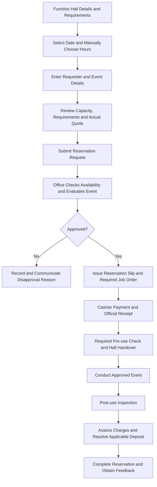

**Hall-specific checks:** actual capacity, event purpose, approved schedule, included amenities versus chargeable requirements, configured payment deadline and applicable damage deposit. Use the Hall's saved configuration; do not inherit the Court's price, capacity or old weekend policy.

### Seven client screens

| Screen | Information and actions | Required outcome |
| --- | --- | --- |
| 1. Facility Details | Actual photos, name, operational status, capacity, rate, location, description, amenities, operating days and rules. Request Booking and Message Admin. | The user understands the resource and its conditions. Open for Booking does not mean every date is free. |
| 2. Select Schedule | Calendar from Django; actual Available Hours / preset slots; manual window selection; Start/End controls where applicable; minimum duration and selected-duration feedback. | An explicitly chosen interval within current operating hours, without conflicts. |
| 3. Booking Details | Full name, organization/office, contact number, email, event/activity, purpose, attendees, additional requirements and notes. Show actual configured fee quantities when applicable. | Complete, valid request details. |
| 4. Review Booking | Facility, selected date/time, duration, requester/event details, requirements, notes and the server-generated cost breakdown. | The user reviews the actual request and current quote. |
| 5. Booking Submitted | Actual booking ID, facility, schedule and Pending Approval status. View Booking Details, Message Admin and Back to Facilities. | One saved request; retries must not create duplicates. |
| 6. Booking Details / Timeline | Actual request progress, payment status, relevant dates, authorized documents and permitted cancellation. | Honest tracking while the admin processes the request. |
| 7. Booking Approved | Actual approval status/time, payment state and available booking-slip/job-order actions. | Approval is visible without automatically marking the booking paid or completed. |

### Venue validation and office processing

- Revalidate the interval when loading a date, requesting a quote, submitting and approving.
- Operating closures, class schedules, maintenance, official campus use and active reservations can prevent a period from being offered.
- Show remaining bookable portions of a partially occupied day only when they satisfy the configured minimum duration.
- Changing dates clears the chosen time window and interval. Refreshing an unchanged, manually chosen window may preserve its unfinished input.
- Enforce facility and attendee capacity, configured client eligibility and verified discount eligibility on the server.
- Additional requirements do not automatically imply an additional fee. Apply only actual configured charges or a separately approved quote.
- Function Hall uses its own saved pricing, deposit and payment deadline. The supplied policy describes full payment two days before the event; the software must use an authorized configuration rather than copying a sample value.
- Pending and approved reservations may already block conflicting schedules. The visible approval/payment/confirmation labels must follow the actual backend definitions rather than implying that unpaid time is free.
- Complete required pre-/post-use inspections. Assess actual damage or additional charges and resolve any deposit balance separately; no automatic refund is implied.

## 5. Hostel Accommodation / Mock Hotel

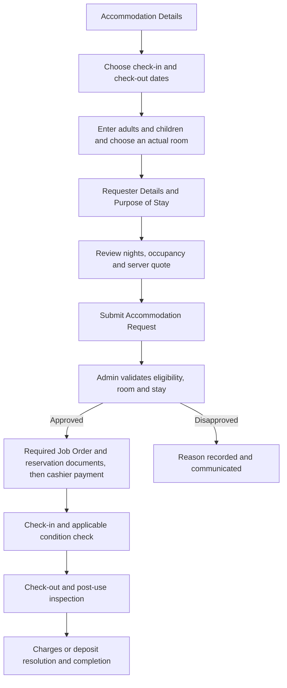

| Area | Required information / behavior |
| --- | --- |
| Stay selection | Check-in and check-out civil dates; checkout must be later than check-in; nights derive from the date range. |
| Guests | Adults, children and total guests. At least one adult; total must fit the selected actual room and applicable facility limits. |
| Room | Configured room ID/name, capacity and current status. Recheck occupancy for every night; never invent rooms because a document mentions a room count. |
| Requester | Full name, contact number, email, organization/office if applicable, purpose of stay and notes. |
| Pricing | Configured per-night or per-person/night rate; eligible shared rate only when occupancy conditions are met; actual configured deposits and extra charges. |
| Eligibility | The supplied Hostel policy specifies internal clients only. That policy requires appropriate server enforcement and verified configuration; it must not be inferred from the requester's typed organization name. |
| Review | Actual room, check-in/out, nights, guest breakdown, applicable quote and terms. Do not reuse the venue Start/End picker as the stay date input. |
| Admin | Room availability, client eligibility, approval/disapproval, documents, cashier receipt, check-in/out, inspections and any damage/deposit resolution. |

Children's pricing, shared-room eligibility and check-in/out times must follow actual configuration. This document does not invent free-child pricing or assume that all rooms share one rate.

## 6. Laboratory Food Analysis

**Basis:** `DPM-USTP-Oro-BEU-004` and the Sir Conmar interview. This is a laboratory service workflow, not an ordinary facility reservation.

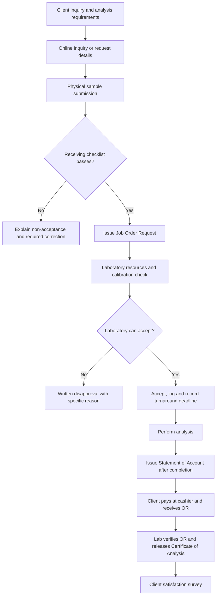

### Client screens and information

| Screen / stage | Content |
| --- | --- |
| Service Details | Actual available analyses, configured fees, requirements, location, confidentiality and turnaround information. |
| Inquiry / Request Form | Requester/contact details, organization, sample/product description, requested configured analyses, sample count, purpose and notes. |
| Review | Requested analyses, sample details, known pricing or office-quotation state, and the physical sample-submission requirement. |
| Request Submitted | Actual request ID and an intake status. Online submission alone does not mean sample acceptance or laboratory approval. |
| Request Tracking | Receiving result, job-order reference, acceptance/disapproval, turnaround deadline, analysis status, issued billing, payment verification and release, when actually recorded. |
| Billing and Results | Issued Statement of Account, actual receipt record and the released result/certificate when authorized. |
| Feedback | Customer Feedback Form after results release. A staff member must not manufacture a completed client survey. |

### Mandatory office gates

1. **Sample receiving:** Administrative Aide checks sealing, minimum quantity/volume, temperature and integrity, including foul smell/leakage. Required quantities depend on the actual analysis; no universal sample size is invented here.
2. **Job order:** Issue the Job Order Request after the sample passes the receiving requirements. Earlier procedure references identify it as `FM-USTP-Oro-BEU-001`; the supplied proposed Word form prints `FM-USTP- ORO-BEU-01`. See [10.4](#104-source-discrepancies-and-confirmation-points) before choosing an official template code. Issuing the request does not itself establish laboratory readiness or acceptance.
3. **Laboratory readiness:** Coordinate with the laboratory technician to verify reagents/chemicals and calibrated, functioning equipment.
4. **Acceptance decision:** If ready, accept and log the work with a real turnaround deadline. If disapproved, issue a specific written explanation.
5. **Analysis:** Laboratory staff perform the requested work. A passed receiving checklist does not itself prove that analysis has started or finished.
6. **Billing:** After analysis, issue the Statement of Account, linked to the actual Job Order Request number and itemized authorized charges. Earlier procedure references identify it as `FM-USTP-Oro-BEU-002`; the supplied proposed Word form has a conflicting printed code. See [10.2](#102-statement-of-account) for the fields and [10.4](#104-source-discrepancies-and-confirmation-points) for the discrepancy.
7. **Payment:** Client pays the Collecting Officer / Cashiering Office and receives an official receipt. Do not require advance payment merely to submit the online inquiry.
8. **Release:** The client presents the OR; the laboratory verifies it and releases the Certificate of Analysis. An uploaded receipt image alone is not verified payment.
9. **Feedback:** Obtain the actual Customer Feedback Form `FM-USTP-Oro-BEU-Survey`.

The interview mentions protein, carbohydrates, fat, fiber, moisture, calorie, pH and total/insoluble solids as inquiry topics. The app must offer only analyses actually configured and supported by the laboratory, not automatically enable every mentioned analysis.

## 7. Training Kitchen / Assessment Center

The supplied policy describes BPP NC II assessment fees and conditions. A complete dedicated assessment operating procedure was not established from the reviewed material; the software sequence below is **proposed** and its precise payment/result-release timing needs office confirmation.

### 7.1 BPP NC II assessment

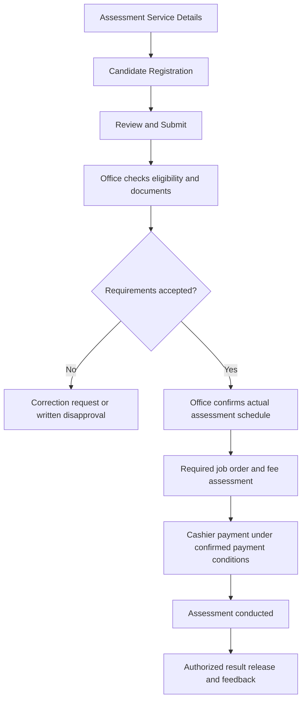

**Registration fields:** full name, contact details, organization/school if applicable, qualification/assessment requested, required eligibility details, preferred date if permitted, supporting documents required by the office and notes.

**Processing rules:**

- A preferred date is not a confirmed assessment slot. Use actual configured schedules, capacity and assessment personnel availability.
- Candidate count and eligibility differ from a venue's event attendee count.
- The policy states non-refundable once scheduled and rescheduling only for valid reasons with prior notice. Do not implement one-click refunds or unrestricted self-rescheduling.
- Verify any student concession against the authorized policy and recorded eligibility; do not trust a user-entered discount claim.
- Record actual attendance, assessment completion and authorized result release. Do not fabricate competency results or automatically issue a TESDA certificate because payment was recorded.
- Confirm the detailed document checklist, payment point, job-order handling and result-release authority with the responsible office before implementing them as mandatory gates.

### 7.2 Training Kitchen as a bookable facility

This is a conditional flow for a kitchen explicitly configured and authorized for facility rental. It is not evidence that every assessment kitchen is available for ordinary rental.

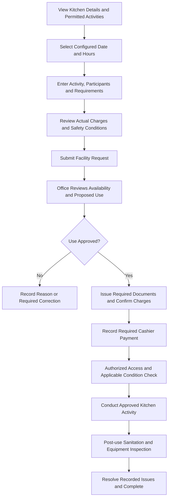

For an assessment-configured resource, use 7.1 instead. For a rental-configured resource, apply its actual safety, supervision, sanitation, capacity and equipment conditions. Do not invent ingredient charges or convert a kitchen rental into an assessment result.

## 8. Lease / Commercial Space Applications

**Basis:** `DPM-USTP-Oro-BEU-002` and the rental policy. Apply the appropriate configured subtype: cafeteria/canteen, food stall, Wi-Fi vendo, photocopying/printing or another approved commercial space.

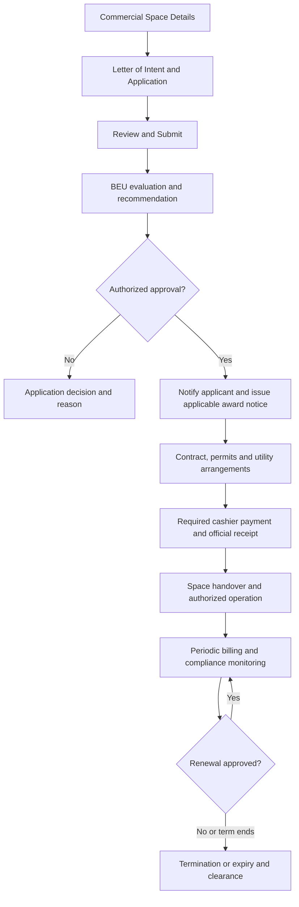

| Area | Application / processing requirements |
| --- | --- |
| Applicant | Name, contact number, email, organization or registered business/operator details. |
| Proposal | Letter of intent, proposed business/activity, requested configured space type and location, intended use and supporting requirements. |
| Space details | Area, machine count or other quantities only when relevant to the selected configured rental basis. |
| Compliance | Required business permit, sanitary permit where applicable, BIR registration and other requirements identified by the responsible office. Record verification rather than treating typed references as automatically approved permits. |
| Evaluation | Actual space availability and permitted use; BEU recommendation and authorized approval decision. |
| Agreement | Signed contract reference, approved dates, rent/billing basis, utilities, responsibilities and conditions. An approved application is not yet a signed or active lease. |
| Payment | Approved charges and actual official receipt. A single payment must not mark every future month paid. |
| Operation | Authorized handover/start, applicable monitoring, subsequent billing, renewal review and termination/expiry. |

Lease rates may depend on term, area, machine count, utilities or agreement. Do not use a venue date/time picker for a monthly lease or automatically renew an agreement without approval.

### 8.1 Cafeteria / canteen spaces

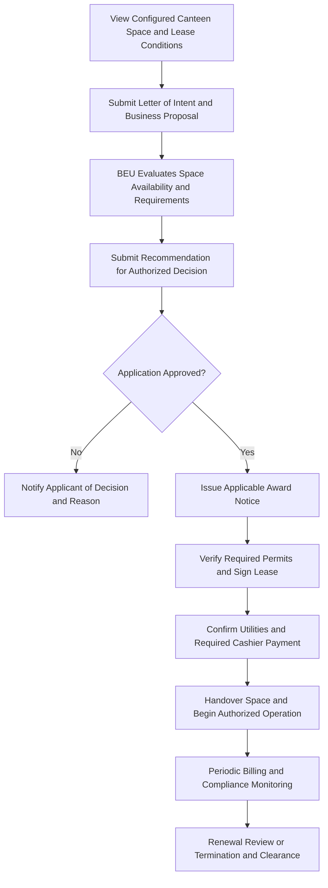

Record the actual assigned area, permitted food business, contract period, electricity/water arrangements and applicable charges. Approval of the application alone does not authorize immediate operation.

### 8.2 Food stalls

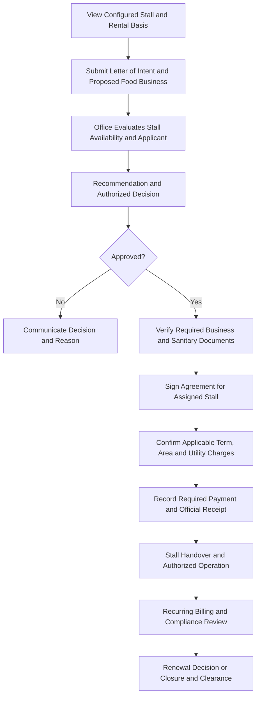

Use actual regular-term/midyear, area-based and utility settings when applicable. Do not assume that a copied standard stall size describes the space actually assigned.

### 8.3 Wi-Fi vendo machine space

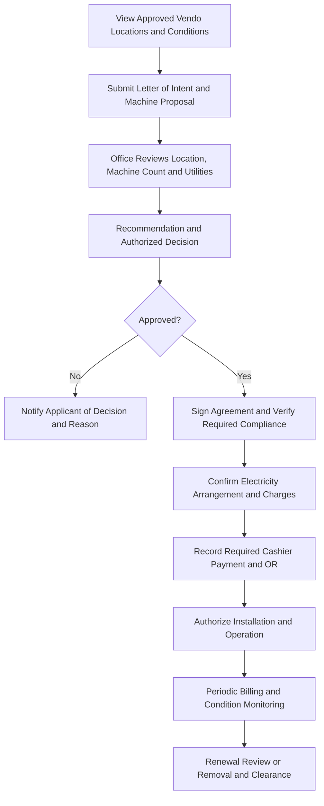

The agreement must identify the actual location and authorized machine quantity. A lease application or a payment does not itself grant installation approval.

### 8.4 Photocopying / printing machine space

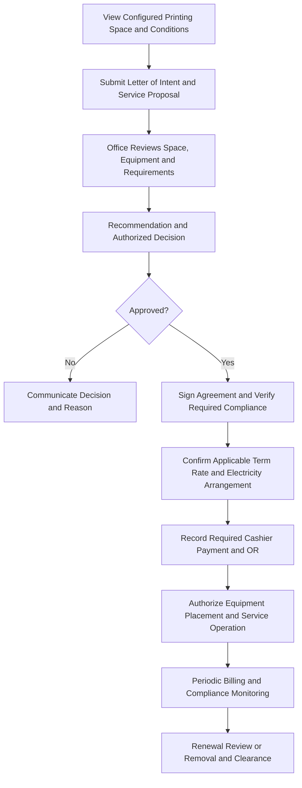

Do not copy the vendo charging basis onto printing/photocopying space. Apply the actual agreement, configured term rates and approved equipment/location.

## 9. Other configured resources

Route using saved category, booking mode and applicable form:

- **Slot:** the venue reservation flow, with that resource's configured rules.
- **Room / Stay:** the accommodation flow, using its real rooms and rates.
- **Assessment:** the assessment workflow when the configuration identifies an actual assessment service.
- **Lease:** the commercial-space application workflow.
- **Daily / Custom / General service:** a resource-specific request, office review and confirmed pricing/schedule. The exact workflow must be explicitly configured; unsupported operations should remain unavailable rather than masquerading as completed online bookings.

Display an honest configuration/office-contact state when the required form, inventory, workflow or price is missing. A name containing “Court,” “Hotel” or “Laboratory” is not sufficient evidence to choose a workflow.

### 9.1 Other physical facilities

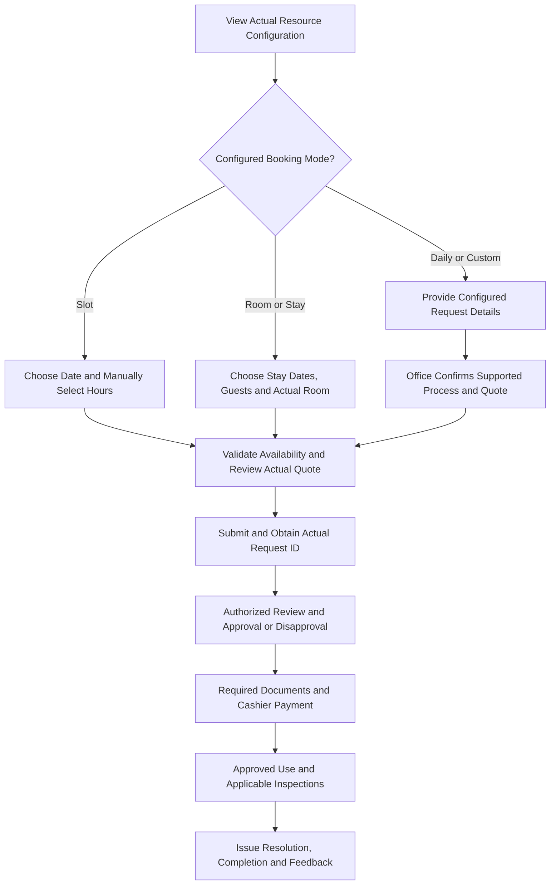

Daily/custom branches are design targets where online support is not yet implemented. Keep an honest office-contact path until the actual request process exists; never show a local-only submission as a saved booking.

### 9.2 Other / custom services

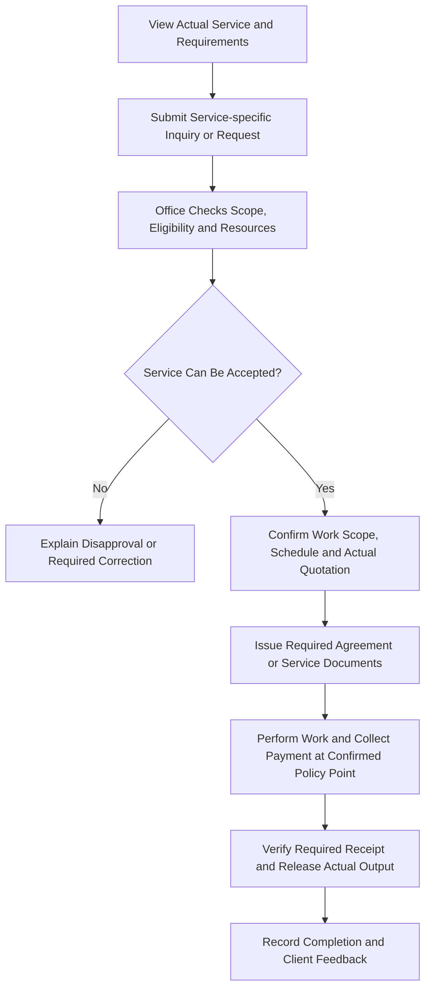

Payment timing, required documents and output depend on that service's authorized process. This general diagram does not replace the more specific laboratory, assessment or lease procedure.

## 10. Job Order Request, Statement of Account and Booking Slip

The two supplied Word files provide the field-level reference for this section. They are named **Propose** and contain blank signature/effective-date fields. Their presence does not prove institutional approval, completed sign-offs, or authorization to change collection procedures. The following document workflow is a specification; current code support is separately described in Section 12.

The **Booking Slip / Reservation Slip** is a third, separate document already described in the project's docs and supported by the application; see [10.6](#106-booking-slip--reservation-slip). It is generated from the saved reservation rather than from either of these proposed Word forms.

### 10.1 Job Order Request

**Purpose:** identify the client, requested work, relevant items and timing, with the appropriate client and office sign-offs. The printed title includes **JOB ORDER Request No.** This transaction number is distinct from the template's document code and from a booking ID.

| Field printed in the form | Meaning and source for future processing |
| --- | --- |
| Job Order Request No.; Date | Actual office-assigned request reference and document date. A draft may remain unnumbered; do not turn the template code into a transaction number. |
| Name of Client; Address | Client details captured for this request and checked before finalization. Preserve the finalized document's values rather than changing history whenever a profile is edited. |
| Gender Preference | Printed choices: Male, Female, Prefer not to say. Do not infer a selection from a name or account profile. |
| Contact Details: Phone No.; Email Address | Actual client contact details for the request. |
| Job or Service Requested | Printed choices: Equipment Rental, Facility Rental, Hotel Accommodation, Training Center, Laboratory Analysis, BPP NCII Assessment. These are form categories, not proof that all six have complete online intake support. |
| Unlabeled blank service line | Preserve as a write-in line. The form does not explicitly label an additional checkbox as Other; do not invent that printed label. Existing application handling of free text is described below. |
| Turnaround time | Blank line beside the laboratory service area. Record the office-confirmed turnaround when applicable; it is not a universal two-week promise or a substitute for the requested service date. |
| Details / Specifics | Actual requested scope: facility/activity or laboratory analysis details, as relevant. Do not insert unrelated questions for every service type. |
| Item(s) | Actual equipment, requirements, samples or other items relevant to the requested work. No cost columns appear in this supplied form. |
| Date and Time Product / Specimen Received at USTP ORO BEU | Actual receipt event when applicable. Online submission is not physical sample receipt; do not prefill this from request creation time. |
| Date and Time Job or Service Required | Requested work timing. It does not establish an accepted laboratory deadline, confirmed assessment slot or approved reservation by itself. |

The form's four signature columns are:

| Printed heading | Printed role | Evidence represented |
| --- | --- | --- |
| Filled-out by | Client | Client's actual completion/sign-off for this document. |
| Assisted by | Administrative Aide | Assistance by the authorized office staff member. |
| Verified by | Personnel In-charge | Verification of the applicable work details by the responsible personnel. |
| Approved by | BEU Manager | Document approval by the authorized manager. This does not automatically record payment or completion of the service. |

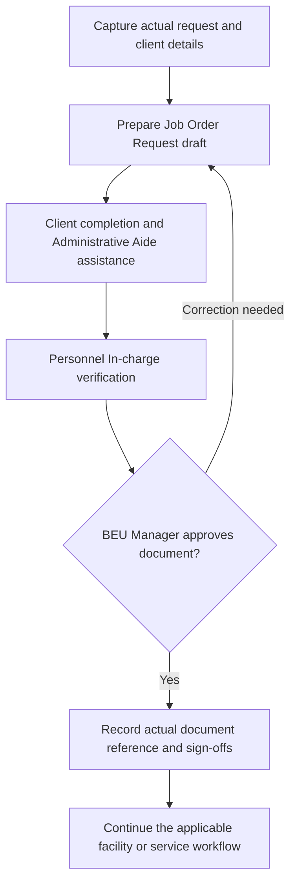

The diagram proposes office processing around the printed roles; the columns alone do not establish a mandatory electronic signing order. Corrections must preserve the reason and invalidate or renew affected sign-offs rather than silently editing an already signed document. Use authorized role assignments, actual signer actions and recorded times; never populate signatures from a typed name alone.

**Laboratory placement:** receiving checklist passes -> Job Order Request -> resource/calibration check -> acceptance or written disapproval -> analysis. The request document must not skip those laboratory gates. **Venue placement:** the existing application prepares eligible booking drafts after booking approval; that behavior does not authorize applying the same approval-first rule to laboratory intake.

### 10.2 Statement of Account

**Purpose:** state the amount due for identified work. A Statement of Account (SOA) is a billing document. It is not an official receipt, payment confirmation or result-release record.

| Field printed in the form | Meaning and source for future processing |
| --- | --- |
| Date; Name of Client; Address | Actual billing date and client details for the issued document. The supplied form does not visibly provide a separate SOA transaction-number field; any application numbering is a future office-confirmed design decision. |
| Total Amount Due | Actual total of authorized line items, consistent with the lower TOTAL field. |
| Payable to | Printed payee: University of Science and Technology of Southern Philippines. |
| Account Name | Printed value: USTP OROQUIETA. |
| Account Number | Blank in the source. Do not invent bank details or turn this blank field into payment-transfer instructions. |
| Details / Specifics | Actual billed work and relevant explanation. |
| Job Order Request No. | Actual Job Order transaction reference for the work being billed; not the form code or an unrelated booking number. |
| Item(s); Unit; Qty; Unit Cost; Amount Due | Authorized itemized charges with their applicable measurement unit, quantity and rate. Calculate each line using the authorized pricing basis and monetary precision; ordinary quantity-based lines use Qty × Unit Cost. |
| TOTAL | Sum of actual line amounts, reconciled with Total Amount Due. Do not add invented fees, discounts, taxes or deposits because an empty line is available. |

The SOA has different signature headings from the Job Order:

| Printed heading | Printed role | Evidence represented |
| --- | --- | --- |
| Prepared by | Administrative Aide | Actual preparation of the billing details. |
| Verified by | Personnel In-charge | Verification of the billed scope, quantities and authorized rates. |
| Approved by | BEU Manager | Approval of the billing document. |
| CONFORME | Client | Actual client acknowledgment/conformity; this signature does not mean cash was received. |

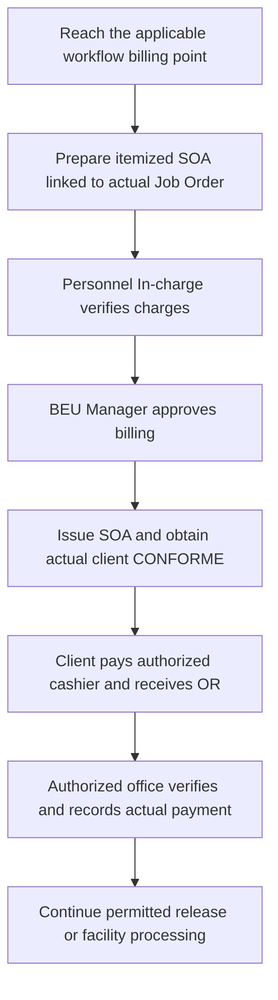

This is a proposed electronic processing sequence around the printed roles. The source form alone does not settle whether client CONFORME must precede issuance or payment in every service; confirm those gates with the responsible office. For **laboratory analysis**, the supplied procedure places billing **after analysis completion**, followed by cashier payment and OR verification before Certificate of Analysis release. Do not move laboratory payment to online inquiry merely to match a venue workflow. Other resources follow their own authorized billing point.

Future software should derive amounts from Django's authorized rates/quote or an approved office assessment, retain the issued document's values, and audit any corrected bill. Creating or signing an SOA must not mark a request paid. Record actual payments and receipts separately; a partial payment must not imply full settlement. The account fields in this proposed form do not change CampusHub's existing authorized cashier/cash-recording workflow or authorize an online payment gateway.

### 10.3 How the documents fit each resource

| Resource / flow | Job Order use | SOA and collection placement |
| --- | --- | --- |
| Covered Court / Function Hall | Facility Rental choice; process the required Job Order alongside the reservation documents. The existing eligible booking draft is not a completed signed document. | Confirm charges under the resource's actual terms; collect at the applicable pre-use payment point. Do not borrow the laboratory's after-analysis timing. |
| Hostel / Mock Hotel | Hotel Accommodation choice; include actual stay/room details in Specifics. | Actual accommodation charges and applicable payment conditions; no guessed nights, rooms or rates. |
| Training Kitchen rental | Facility Rental or Training Center only as the responsible office classifies the authorized use. | Actual configured rental/equipment charges and payment conditions; no automatic assessment fee. |
| BPP NCII assessment | The form explicitly includes BPP NCII Assessment. Eligibility, scheduling, document approval and payment order still need the assessment office's confirmed procedure. | Actual approved assessment fees and confirmed payment timing. The existence of a checkbox does not complete that procedure. |
| Laboratory Food Analysis | Laboratory Analysis choice; after sample receiving checks and before the laboratory readiness/acceptance gates. | SOA after analysis; link actual Job Order Request No.; cashier OR verification before results release. |
| Commercial lease subtypes | The form has no explicit Lease Application choice. Do not require a rental Job Order merely from the name; retain letter of intent, evaluation and agreement as the primary flow. | Apply actual agreement/periodic billing and office-confirmed documents. Do not treat a generic SOA as a signed lease or all future rent as paid. |
| Equipment rental / Other | Equipment Rental is a printed choice, but does not by itself establish configured inventory or online intake. Use the actual configured workflow and office classification. | Confirm scope, inventory, quote and billing point before issuing charges. Unsupported workflows remain honest office-contact paths. |

### 10.4 Source discrepancies and confirmation points

| Source observation | Documentation / implementation treatment |
| --- | --- |
| SOA filename contains `BEU-02`, but its printed code is `FM-USTP-ORO-BEU-01`, also used by the Job Order form apart from spacing. | Confirm the correct SOA document code with BEU/document control. Do not silently rewrite the supplied DOCX, rename an official code, or describe the mismatch as already corrected. |
| Earlier process references use `FM-USTP-Oro-BEU-001` and `FM-USTP-Oro-BEU-002`; the supplied proposed forms use the shorter `01`/filename `02` convention. | Preserve both source conventions explicitly until the authorized current identifiers are confirmed. Template code, Job Order transaction number and booking ID remain distinct. |
| Both filenames start with Propose; effective dates and signature fields are blank, with revision 00 and page 1 of 1. | Treat as proposed templates, not evidence of approval, a live effective date, or completed sign-offs. |
| The interview connects Job Orders with rates, but the supplied Job Order has no monetary columns; the SOA provides Unit, Qty, Unit Cost and Amount Due. | Describe scope in the Job Order and itemized billing in the SOA. Confirm any required rate attachment or revised Job Order rather than inventing printed charge columns. |
| The SOA's Account Number is blank. | Keep unknown details unknown. Existing cashier/OR processing remains authoritative. |
| Signature headings identify roles, not current staff names or software permissions. | Confirm the authorized roster and required sequencing. Never assign a signer simply because an account is an admin or a name appeared in an old source photograph. |

### 10.5 Client and admin document behavior

For the proposed complete workflows, show authorized Job Order and SOA documents within the actual request details. Distinguish Draft, required sign-offs, issued document, billing due and recorded payment using real saved evidence. A document preview is not evidence that it was issued, signed or paid. Client access must be owner-scoped; staff access and signing must be permission-checked by Django. Keep signature images and private document evidence out of public catalog/media responses.

Use the existing Job Order implementation where suitable, rather than creating a second booking document ledger. SOA integration and the unsupported service workflows require separate implementation; adding their diagrams here does not enable them.

### 10.6 Booking Slip / Reservation Slip

**Purpose:** show the saved reservation, requester, facility, schedule, charges and recorded payment details. The existing [Booking Slip guide](booking-module-chatgpt-context.md#booking-slip) and [official digital slip specification](facility-configuration.md#official-digital-booking-slip-inside-booking-details---2026-10-14) describe this document. Printing or downloading it does not create another booking, approve a request or record payment.

| Resource | Existing form title |
| --- | --- |
| Covered Court / Function Hall | Facilities and Spaces Rental Booking Slip |
| Hostel / room accommodation | Room Accommodation Booking Slip |
| Other physical resource | Its configured supported form, such as Custom / General Booking Form. Do not invent a rental slip for a laboratory request or lease application. |

The title resolver preserves a saved quote's form label first, then the saved workflow form type, then the current facility configuration when no historical form evidence exists. A legacy record with invalid/missing configuration retains the generic Booking Slip fallback. Reclassifying a facility must not silently rename its historical forms.

The rental slip's eight sections map to saved data as follows. Accommodation/general forms use their corresponding reservation layout and stay fields rather than forcing this rental layout onto every resource.

| Rental slip section | Existing source and behavior |
| --- | --- |
| 1. Client / Requestor Information | Saved name, organization/office, address, contact number and email; permitted linked-profile fallbacks for actual contact details. |
| 2. Event Information | Saved event/activity name, nature/purpose and expected participants. |
| 3. Facility Requested | Actual linked facility/category and applicable Court, Hotel Function Hall or Others selection. |
| 4. Schedule of Use | Actual booking date, start and end time. Accommodation instead uses actual check-in/out, nights, guests and room information. |
| 5. Equipment / Additional Requirements | Only the client's saved requested requirements and write-in details. A facility amenity is not automatically a requested paid item. |
| 6. Rental Fees | Recorded quote values and booking amounts. Unknown equipment fees stay unknown; do not classify every configured extra charge as equipment or use today's rate to rewrite an old quote. |
| 7. Approval | Requested By, Reviewed By (Campus Admin / Facility In-Charge), Approved By. Configured names identify signatory lines; they are not evidence that those people actually signed. These differ from the four Job Order and SOA roles. |
| 8. Payment Details | Existing paid payment records, recorded amounts, official receipt references and payment dates. Missing OR/date values remain Not recorded. The slip itself is not an OR. |

Booking number and request date also come from the actual saved booking. **Generated** means the application rendered that record; it does not mean **Approved**, **Signed** or **Paid**.

| Document | What it answers | What it does not establish by itself |
| --- | --- | --- |
| Booking Slip / Reservation Slip | What reservation and schedule were recorded? | Approval, an actual signature or receipt of payment. |
| Job Order Request | What work/items were requested and which document sign-offs were recorded? | Full payment, completed work or laboratory readiness/acceptance. |
| Statement of Account | What authorized charges are due for the linked work? | Receipt of cash or permission to release laboratory results. |
| Official Receipt | What payment did the authorized cashier acknowledge? | Booking approval, a signed lease or completion of the requested service. |

**Place in the client flow:** actual request saved -> show submission/tracking -> office decision -> expose the permitted Booking Slip action with the actual status -> process the applicable Job Order/billing/payment steps -> required inspections/use/completion. Staff may view a generated slip earlier when authorized; that does not turn a pending request into an approved reservation. Historical/cancelled records retain their permitted document access without gaining edit rights.

**Existing data flow:** saved `Booking` + request metadata/quote + actual paid `FacilityPayment` records -> `booking_slip_data` -> shared official slip preview -> native browser Print or `booking_slip_pdf` export. The same presentation values feed the output paths. Editing, where permitted, changes the original reservation through its existing validation and quote review; it does not create an independently editable copy of the paper.

Use the existing [print/PDF guide](facility-configuration.md#native-browser-print-and-matching-chrome-pdf-export---2026-10-15) for export troubleshooting. An unavailable server PDF renderer must show its real error; a successful HTML preview is not proof that PDF export succeeded. No print/PDF verification was rerun for this documentation update.

## 11. Status and evidence model for future implementation

The current `Booking` model has Pending, Approved, Rejected, Cancelled and Completed. The additional labels below are **proposed operational stages**, not claims that new database statuses already exist.

| Flow | Proposed operational stages / evidence |
| --- | --- |
| Venue | Submitted; review; approval/disapproval; issued documents; cashier payment; required inspections; actual use; damage/deposit resolution; completion; feedback. |
| Accommodation | Submitted; room/stay review; approval; payment; check-in; check-out; inspection/resolution; completion. |
| Laboratory | Inquiry; sample inspected; job order issued; laboratory readiness checked; accepted/logged; analysis; analysis complete; SOA issued; OR verified; results released; feedback. |
| Assessment | Registered; requirements reviewed; actual schedule confirmed; required documents/charges; payment; assessment completed; authorized results released; feedback. Detailed ordering requires office confirmation. |
| Lease | Submitted; evaluated; recommended; approved/disapproved; notified; contract signed; required permits verified; payment; handover/active; subsequent monitoring/billing; renewal or closure. |

For each saved transition, future processing should record the actual actor, event time, old/new stage, required evidence/reference and a reason where applicable. Client APIs must exclude internal staff notes and private evidence that the requester is not allowed to view.

Cancellation rules must follow each resource's terms and current state. A request cancellation does not automatically refund cash, erase an OR, cancel a signed lease, or reverse laboratory work already performed.

## 12. Current application readiness and implementation boundaries

| Area | Confirmed local implementation | Remaining work for the target flow |
| --- | --- | --- |
| Slot-based mobile booking | Existing Select Schedule, requester form, review, submission, status/history, quote and conflict validation. | Align any remaining presentation/progress details with the specification without copying reference sample data. |
| Hostel accommodation | Existing Django room/stay schedule and quote helpers and admin booking processing. The current mobile details action hands off to Message Admin for unsupported non-slot flows. | Dedicated mobile room/stay availability, form, quote, submission and tracking integration. |
| Laboratory / assessment / lease mobile | Service catalog and details with office-request guidance. `online_requests_available` is currently `False`. | Actual intake, review/submission, owner-scoped history/tracking, evidence-aware admin transitions and relevant documents. |
| Admin Service Requests | Existing listing and read-only request details. | Authorized processing actions, required evidence, document/payment handling and real stage/event persistence. |
| Timeline timestamps | The current mobile status screen uses `created_at` for its visible approval date. | Use actual recorded approval/review/payment/release events; unknown times must remain unknown. This document does not fix that code. |
| Job Order documents | Existing eligible booking drafts, six service choices, write-in handling, document rendering, signature authorization and a Flutter Job Order screen. Draft generation excludes the unsupported service types/modes. | Do not equate this booking document support with complete laboratory/assessment/lease intake. Reconcile office-approved form codes and extend only where the relevant workflow exists. |
| Statement of Account | The service configuration names a billing/SOA payment point; no dedicated SOA issuance workflow was found in the inspected facilities/mobile source. | Linked itemized billing, actual sign-offs, authorized document access, corrections and separate receipt/payment integration. Existing JSON references or configuration labels alone do not implement these steps. |
| Booking Slip / Reservation Slip | Existing saved-data presentation, category-based form title, shared official preview, browser printing and protected PDF export. | Preserve its distinct role and historical values when implementing the additional workflows. A generated slip must not be treated as a signed Job Order, SOA or OR. |

The stopped online-intake implementation was removed. This document does not recreate `online_request_views.py`, `services/online_requests.py` or new online-request routes.

### Relevant existing functions, inputs and outputs

Paths are relative to the project root. Line numbers refer to the inspected local source; use the named anchor if earlier edits shift a line.

| File / current anchor | Inputs | Output and role |
| --- | --- | --- |
| `backend/core/modules/facilities/mobile_views.py:83` — `availability` | Facility ID and requested date/month; authenticated eligibility when supplied. | Actual day/month slot status JSON. No booking is created. |
| `backend/core/modules/facilities/mobile_views.py:139` — `quote` | Facility, requested interval and request details. | Server validation/quote response; pricing remains authoritative in Django. |
| `backend/core/modules/facilities/mobile_views.py:185` — `bookings` | Bearer-authenticated client and validated submission / request key. | Existing slot-booking creation or owner-scoped booking history. This is not a universal service-intake endpoint. |
| `backend/core/modules/facilities/services/operating_schedule.py:114` — `booking_day_restriction` | Workflow configuration and civil date. | Restriction reason or no restriction, derived from operating hours. |
| `backend/core/modules/facilities/services/operating_schedule.py:133` — `validate_schedule_change` | Existing facility and proposed workflow. | Rejects changes that would exclude protected active reservations/stay nights. |
| `backend/core/modules/facilities/services/admin_reservations.py:85` — `reservation_schedule` | Configured physical resource, interval or stay/room, guest data. | Validated fields/context or a validation error; performs no reservation write itself. |
| `backend/core/modules/facilities/services/admin_reservations.py:185` — `reservation_quote` | Validated request fields and saved pricing configuration. | Fields and calculated quote; no client-entered arbitrary total. |
| `backend/core/modules/facilities/mobile_services.py:20` — `serialize_service` | Existing service-configured facility record. | Public allowlisted catalog details; internal configuration is not broadly exposed. |
| `backend/core/modules/facilities/service_views.py:23` — `admin_service_requests_page` | Authorized admin and list filters. | Paginated existing service-request rows; currently no full processing state machine. |
| `campushub/lib/module_app/screens/facilities/facility_booking_screen.dart:362` — `_resetTimeSelection` | No arguments; existing screen state. | Clears the chosen hours/time draft without removing fetched availability. |
| `campushub/lib/module_app/screens/service_details_screen.dart:27` — `_requirements` | Selected service. | Existing requirements/office-contact guidance, not a saved online request. |
| `backend/core/modules/facilities/services/job_order.py:38` — `add_job_order_draft` | Booking and mutable request details; uses eligibility checks and saved facility/request data. | Adds a missing draft to the supplied details without inventing a request number or signatures; callers persist it within their existing transaction. |
| `backend/core/modules/facilities/services/job_order.py:154` — `current_job_order_data` | Booking, saved Job Order metadata and optional booking row. | Plain Word field values: client details, selected categories, write-in, specifics, items and actual times. |
| `backend/core/modules/facilities/services/job_order_signatures.py:89` — `can_sign` | Booking, signature section, authenticated user and source. | Boolean authorization for that signature action, using booking state, owner or configured staff assignment and existing signature evidence. It does not record payment. |
| `backend/core/modules/facilities/services/job_order_docx.py:154` — `job_order_docx` | Prepared document field data and applicable template. | Word document bytes populated from the template, including available signature evidence. Rendering is separate from billing/payment processing. |
| `campushub/lib/module_app/screens/facilities/job_order_screen.dart:22` — `JobOrderScreen` | Actual `bookingId`. | Existing client Job Order screen; its presence does not create an SOA or a new service-intake endpoint. |
| `backend/core/modules/facilities/services/booking_slip.py:43` — `booking_slip_data` | Saved booking, optional canonical booking row, metadata/quote and recorded paid payments. | Read-only presentation dictionary for the official slip, including sections, choices, signatory lines and actual payment references. |
| `backend/core/modules/facilities/services/rental_configuration.py:28` — `booking_slip_label` | Facility plus optional saved quote and workflow snapshot. | Historical form title first, with current configuration/generic fallback only when necessary; no record write. |
| `backend/core/modules/facilities/services/booking_slip_pdf.py:39` — `booking_slip_pdf` | Slip presentation dictionary. | PDF bytes from the shared HTML/CSS renderer, or an export error; no booking/payment write. |

### Data flow

**Existing venue flow:**

```text
Saved Facility configuration and actual bookings/schedules
  -> Django availability / quote validation
  -> Flutter calendar and manual hours selection
  -> Requester details and server quote review
  -> Authenticated submission with stable request key
  -> Booking + FacilityBookingRequest records
  -> Authorized admin processing + FacilityPayment records
  -> Owner-scoped details/history and permitted documents
```

**Proposed additional flows:**

```text
Configured service or accommodation
  -> Type-specific client form
  -> Server validation and review/quotation as appropriate
  -> Actual saved request
  -> Permission-checked office processing with evidence
  -> Official payment / document / release events
  -> Owner-scoped progress and permitted feedback
```

Reuse the existing Django source of truth where suitable; do not duplicate the booking/payment ledger or move business processing into FastAPI. Any future decision about additional models, JSON structure or migrations must be evaluated during implementation, not treated as already completed by this specification.

**Document data flow:** existing eligible booking details -> `add_job_order_draft` -> persisted booking request metadata -> `current_job_order_data` / signature-aware document data -> authorized preview, signing and Word/PDF rendering. In the proposed SOA extension, the actual Job Order reference and approved pricing feed itemized billing at that workflow's billing point -> office verification/approval and actual client acknowledgment -> issued bill -> separate cashier receipt/payment evidence -> permitted release or use. The SOA branch is a design target, not an existing universal pipeline.

## 13. Verification and safe learning exercise

Related implementation guides: [Bookings](booking-module-chatgpt-context.md), [Facility configuration](facility-configuration.md), [Service configuration](service-configuration.md), and [Mobile Services navigation](mobile-services-navigation.md).

### Acceptance checks for future implementation

- Venue date changes never automatically choose hours or carry the old interval onto the new date.
- Concurrent or stale submissions cannot bypass conflict checks or create duplicate requests.
- A hostel stay cannot exceed actual room capacity or overlap an active reservation for that room/night.
- A service request never becomes a reservation merely because the service catalog is active.
- A laboratory request cannot start analysis before receiving and readiness checks, or release results before the required OR verification.
- A disapproved request has a recorded, specific reason.
- An assessment preferred date does not become an approved slot without office confirmation.
- A lease application cannot become an active lease solely through submission or payment.
- Client/role access is enforced by Django on reads, writes and private document access.
- Unknown prices, timestamps, sample quantities, deadlines and document references are not invented.
- Approval, payment, completion and release remain separate recorded events.
- Job Order numbers refer to actual requests; SOA line totals reconcile with both total fields and authorized rates.
- A Job Order draft, SOA approval or client CONFORME never records cashier payment or laboratory acceptance by itself.
- Required signature roles use actual authorized signers and evidence. Unknown effective dates, account numbers and disputed document codes are not guessed.
- Physical sample receipt and required-service time remain distinct from online submission and actual turnaround deadlines.
- Generated Booking Slips preserve recorded form/quote information and never stand in for an actual approval, signature, SOA or official receipt.
- Errors retain the user's input and explain the next action; missing data remains an honest empty state.

### Safe practice

Trace an existing venue request without modifying working records: locate `availability`, follow it into the Flutter date loader, and identify where `_resetTimeSelection` clears selection while retaining the returned slots. Compare that with the laboratory diagram: sample receiving and laboratory acceptance cannot be replaced by choosing a calendar slot. Then identify one missing service-intake capability in the readiness table and explain its required input, permission, saved evidence and client-visible output. Use isolated test fixtures for any later coding exercise.

For the document flow, trace the source form's **Date and Time Product / Specimen Received** into `current_job_order_data`'s `received_at` output. Verify that an unknown value stays blank and is not replaced with request creation time. Then trace **Job Order Request No.** into the proposed SOA: explain why a template code cannot fill that field and why client CONFORME cannot replace an official receipt. Compare the SOA's Qty × Unit Cost line calculation with its TOTAL using a blank worksheet or isolated fixtures; do not modify working bills or sign as another person.

For the Booking Slip, locate `booking_slip_label` and follow the saved quote's `form_label` into `booking_slip_data`. Verify on paper that a historical saved label takes precedence over a later facility category change. Then locate the payment section and explain why a printed OR field requires an actual paid payment record. Use code inspection or isolated fixtures, without editing working reservations or receipts.

### Documentation change report

1. **Cause / reason:** The user requested Markdown process flows, supplied the proposed Job Order/SOA forms, then asked to look in the docs for the Booking Slip.
2. **Exact file changed:** `docs/facilities-services-process-flows.md` — this specification; Booking Slip details are in Section 10.6, with supporting references, readiness, function/data-flow and learning updates in Sections 1, 2 and 12–13. No source DOCX or application code was edited.
3. **Changes made:** The guide retains 15 Mermaid diagrams, including separate Job Order and SOA flows. Added the existing rental/accommodation Booking Slip mapping, eight rental sections, document comparison, workflow placement and links to the established slip/print guides.
4. **How it works:** This file is a human-readable design/engineering reference. It is not loaded by the application and executes no code.
5. **Backend / API behavior:** No runtime changes; proposed workflows are explicitly separated from existing capabilities.
6. **Database / migration impact:** None. No working records, prices, rooms, accounts or permissions were changed.
7. **Verification performed:** Earlier review covered the policy/interview, procedure photographs/reference image and both supplied DOCX files' main/header XML. For the Booking Slip addition, searched the existing docs and inspected `booking_slip_data`, `booking_slip_label` and the PDF entry point; checked Markdown structure, relative links, cross-document anchors and whitespace. No application tests, print/PDF export or visual DOCX/Mermaid rendering were run for this documentation-only change.
8. **Remaining limitations:** Confirm the SOA's conflicting printed code, current approved template identifiers/effective dates, authorized signer roster, exact sign-off sequencing and assessment procedure before implementation. This document does not create online intake, SOA issuance, payment transfers or an amendment to institutional policy.
